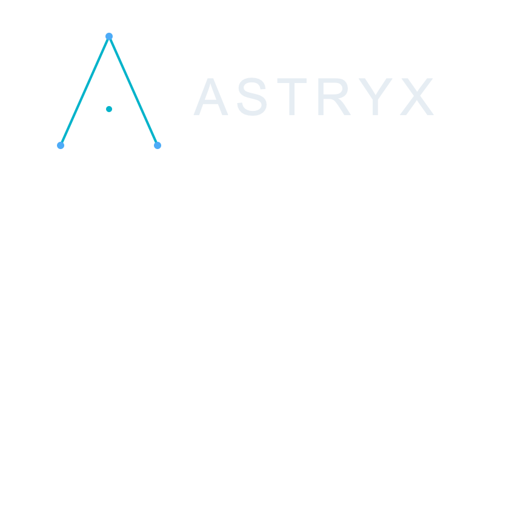

<p align="center">
  
</p>

## Theme for VS Code, Cursor, Windsurf, and Zed — for all the people who love to code in deep dark spaces.

----------

## Installation

### VS Code, Cursor, or Windsurf

1. Search for **Astryx** in **Extensions** in the sidebar (when published), or install from the [repository](https://github.com/BrankoSlavkov/astryx) (e.g. a release `.vsix`) if you are developing the theme.
2. Click **Install** to add the theme.
3. Open the **Command Palette** and select **Preferences: Color Theme** (or **Cursor: Color Theme** / equivalent). This lists the themes you have installed.
4. Select **Astryx** to activate it.

To build and install a VSIX from this repository:

```bash
bun install
bun run package
```

Then use **Extensions: Install from VSIX…** and pick `astryx-0.1.0.vsix`.

While developing the VS Code–compatible extension, open this repository in the editor and press **F5** to launch an Extension Development Host and preview **Astryx** without installing a VSIX.

The `package` script passes `--allow-package-all-secrets` and `--allow-package-env-file` so `vsce` skips secret scanning for minimal theme packages.

### Zed

Use **Extensions → Install Dev Extension** and choose the [`zed/`](zed/) folder. See [`zed/README.md`](zed/README.md) for details.

----------

## Publish to the Visual Studio Marketplace

Follow the [official publishing guide](https://code.visualstudio.com/api/working-with-extensions/publishing-extension). Summary:

1. **Publisher ID** — [`package.json`](package.json) uses `"publisher": "astryx"`. Create a publisher with **that exact ID** (or change `publisher` in `package.json` to match the ID you register). [Create or manage publishers](https://marketplace.visualstudio.com/manage).

2. **Personal Access Token (PAT)** — In [Azure DevOps](https://dev.azure.com), open **User settings → Personal access tokens → New Token**. Set **Organization** to **All accessible organizations**, **Expiration** as you prefer, and under **Scopes** choose **Custom defined** → **Marketplace** → **Manage** (Acquire & Manage). Create the token and copy it once.

3. **Log in** (from this repo, with `bun` / `vsce` available):

   ```bash
   bunx vsce login astryx
   ```

   Paste the PAT when prompted. Alternatively set `VSCE_PAT` to the token and run `bun run publish` (some setups skip `login` when `VSCE_PAT` is set—see `vsce --help`).

4. **Publish** — Ensure the repo is in good shape, then:

   ```bash
   bun run publish
   ```

   For later updates, bump `version` in [`package.json`](package.json) (or use `bunx vsce publish patch` / `minor` / `major` per the docs), then publish again.

The marketplace `icon` is [`assets/icon.png`](assets/icon.png) (PNG required by `vsce`; SVGs are not allowed for icons or README images).

**Open VSX** (Cursor, VSCodium, etc.): publishing is separate; see [Publishing Extensions](https://github.com/eclipse/openvsx/wiki/Publishing-Extensions) and the `ovsx` CLI if you want listings there too.

### Verified publisher badge (optional)

You **do not need a domain** to publish or use the Marketplace. Many extensions only link to **GitHub** (this repo’s [`homepage`](https://github.com/BrankoSlavkov/astryx) is set in `package.json`). The **verified** badge is extra: Microsoft requires proving control of a real domain (TXT record in DNS). **`github.io` and similar hosts do not qualify** as the verified domain. If you do not own a domain, skip verification—your listing is still normal.

If you ever want the badge, you’d register a domain you control (any common registrar), point it at a small HTTPS site, then follow [Verify a publisher](https://code.visualstudio.com/api/working-with-extensions/publishing-extension#verify-a-publisher) after the **6‑month** publisher and domain-age rules apply.

**Prerequisites (from Microsoft), when you choose to pursue verification:**

- Your publisher has had one or more extensions on the VS Marketplace for **at least 6 months**.
- The domain’s registration is also **at least 6 months** old.

**Rough flow:** [Marketplace publisher management](https://marketplace.visualstudio.com/manage) → select your publisher → **Details** → **Verified domain** → enter an [eligible domain](https://code.visualstudio.com/api/working-with-extensions/publishing-extension#eligible-domains) (you can manage DNS with a TXT record; not a subdomain like `*.github.io`; site must use **HTTPS** and respond with **HTTP 200** to a **HEAD** request) → **Save** → **Verify** → add the TXT record Microsoft gives you → **Verify** again in the dialog. The Marketplace team reviews within about **5 business days**. Changing your publisher **display name** later revokes the badge.

----------

## Credits

Astryx is inspired by [Celestial](https://github.com/apvarun/celestial-theme) — a modified (darker) take on the [Horizon](https://marketplace.visualstudio.com/items?itemName=jolaleye.horizon-theme-vscode) theme by [Jonathon](https://marketplace.visualstudio.com/publishers/jolaleye). The VS Code color theme JSON follows Celestial’s palette. The Zed theme was bootstrapped from the [Dracula for Zed](https://github.com/dracula/zed) structure and recolored; refine further in the [Zed Theme Builder](https://zed.dev/theme-builder) if you like.

## License

[MIT](LICENSE)
